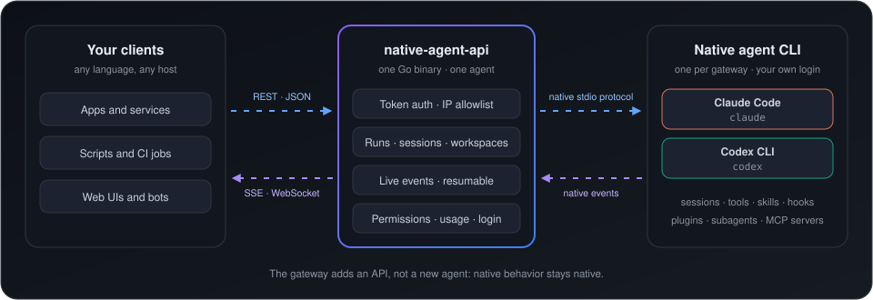
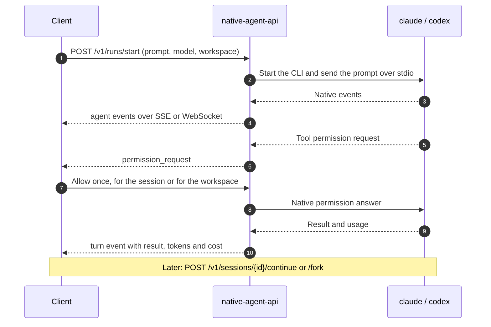

# native-agent-api

[](https://github.com/emreuyguc/native-agent-api/actions/workflows/ci.yml)
[](LICENSE)

**An HTTP API for Claude Code and Codex CLI.** native-agent-api runs the real coding-agent CLI and
serves it over REST, Server-Sent Events and WebSocket. Sessions, login, tools, skills, hooks,
plugins, subagents and MCP servers keep working exactly as in a terminal.

<p align="center">
  
</p>

> **Status: 0.x.** The API may still change between minor versions; see the [changelog](CHANGELOG.md).

## Why

Coding-agent CLIs are built for a person at a terminal. Using one from an application usually
means scraping the terminal or rebuilding the agent on a model API, and losing its native features.

native-agent-api gives the CLI an API instead:

- **Native, not re-implemented.** The gateway drives the CLI's own protocol. Every native event
  reaches the client unchanged, and the agent's features keep working.
- **One API for every agent.** Runs, sessions, events, permissions and usage look the same for
  Claude Code and Codex CLI. Agent-only data stays in a typed `provider` section.
- **Your machine, your login.** You run the gateway and sign the CLI in with your own account.
  The gateway adds no service between you and the agent.

## Features

| Area | What you get |
|---|---|
| **Runs** | One-shot asks, or interactive runs you can message, interrupt, close and cancel |
| **Sessions** | Continue with remembered settings, fork, list and delete |
| **Live events** | SSE and WebSocket; reconnect without losing events; optional partial output |
| **Permissions** | Approve or deny each tool use from the client, once or for a session or workspace |
| **Workspaces** | Managed workspaces with a file API, or attached project directories |
| **Native features** | Tools, skills, hooks, plugins, subagents, MCP servers, native control requests |
| **Results and usage** | Structured output, turn and session tokens, context window, cost (Claude Code), subscription allowance |
| **Agent management** | Login without a terminal, logout, status, model list, diagnostics |
| **Security** | Token auth, IP allowlist, DNS-rebinding and cross-origin protection, redacted logs |
| **Operation** | Explicit configuration, generated OpenAPI 3.1, optional hardened Docker setup |

Per-agent details are in the [roadmap and feature status](ROADMAP.md).

## How a run works



## Supported agents

| Agent | Native CLI | Support |
|---|---|---|
| `claude` | Claude Code | [Support details](docs/agents/claude-code.md) |
| `codex` | Codex CLI | [Support details](docs/agents/codex-cli.md) |

One gateway process serves one agent. Run two processes to serve both.

## Quick start

Requires macOS or Linux, Go, and the agent CLI on `PATH`.

```sh
git clone https://github.com/emreuyguc/native-agent-api && cd native-agent-api
go install ./cmd/native-agent-api
cp .env.example .env && chmod 600 .env   # every setting is explicit; review the file
native-agent-api new-token               # client token for $TOKEN, digest for NATIVE_AGENT_TOKEN_SHA256
native-agent-api login claude
native-agent-api serve --env-file .env
```

```sh
curl -s http://127.0.0.1:8080/v1/ask -H "Authorization: Bearer $TOKEN" -H 'Content-Type: application/json' \
  -d '{"prompt":"Explain HTTP/2 in one sentence.","model":{"id":"sonnet","effort":"low"}}' | jq -r .result.text
```

The interactive API reference is served at `/docs`, and the OpenAPI 3.1 document at
`/openapi.yaml`. For Docker, see [docker/README.md](docker/README.md).

## Documentation

- [API concepts](docs/api.md): runs, sessions, events, permissions, provider sections
- [Configuration](docs/configuration.md): every `NATIVE_AGENT_*` setting
- [Security model](docs/security.md): read this before exposing the gateway
- [Roadmap and feature status](ROADMAP.md): what works per agent, what is planned
- [Platform support](docs/platforms.md), [development](docs/development.md),
  [testing](docs/testing.md)

## Notes

native-agent-api is an independent project, not affiliated with Anthropic or OpenAI. It uses the
CLI and the login you provide; your use of each CLI and account stays subject to that provider's
terms, so check them before serving a personal subscription to other people or applications.

Vulnerabilities: see [SECURITY.md](SECURITY.md). Contributions: run `make check` before a pull
request. License: [Apache-2.0](LICENSE).
