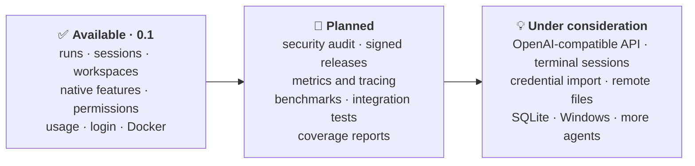

# Roadmap and feature status

What native-agent-api does today and where it is going. Planned items and ideas are directions,
not promises or dates, and suggestions are welcome. Released changes are listed in the
[changelog](CHANGELOG.md).

**Legend:** ✅ available · 🚧 planned · 💡 under consideration · ➖ not offered by the native CLI

## ✅ Available

### Runs and sessions

| Feature | Claude Code | Codex CLI |
|---|:-:|:-:|
| One-shot ask, with or without a workspace | ✅ | ✅ |
| Interactive runs: messages, interrupt, close, cancel | ✅ | ✅ |
| Live events over SSE (resumable) and WebSocket | ✅ | ✅ |
| Partial output | ✅ | ✅ |
| Structured output (`output.schema`) | ✅ | ✅ |
| Continue with remembered settings, fork, list, delete | ✅ | ✅ |
| Managed workspaces, attached host directories, file API | ✅ | ✅ |

### Native agent features

| Feature | Claude Code | Codex CLI |
|---|:-:|:-:|
| Tools, skills, hooks, MCP servers, plugins | ✅ | ✅ |
| Subagents and project instructions | ✅ | ✅ |
| Native control requests in both directions | ✅ | ✅ |
| Task, subagent and process observations | ✅ | ✅ |
| Tool permissions: `bypass` or `ask`, scoped once, per session or per workspace | ✅ | ✅ |
| File checkpoints and rewind | ✅ | ➖ |
| Debug output as `diagnostic` events | ✅ | ➖ |

### Usage and account

| Feature | Claude Code | Codex CLI |
|---|:-:|:-:|
| Turn tokens and context window | ✅ | ✅ |
| Run and session token totals | ✅ | ✅ |
| Turn and conversation cost | ✅ | ➖ |
| Subscription allowance | ✅ | ✅ |
| Login without a terminal, logout, status | ✅ | ✅ |
| Model list with reasoning efforts, diagnostics | ✅ | ✅ |

### Operation

| Feature | Status |
|---|:-:|
| Token auth, IP allowlist, DNS-rebinding and cross-origin protection | ✅ |
| Redacted logs, explicit agent environment | ✅ |
| Hardened Docker setup per agent, optional restricted egress | ✅ |
| Generated OpenAPI 3.1 document and `/docs` reference | ✅ |

`GET /v1/agent` returns the machine-readable capability list of the served agent.

## 🚧 Planned

| Area | Item |
|---|---|
| Security | Audit of token handling, secret files, allowlists, proxy headers and rate limits |
| Releases | Signed, checksummed binaries; multi-architecture images with an SBOM; versioning policy |
| Observability | Metrics (requests, runs, native processes, tokens); optional tracing to the native process |
| Performance | Benchmarks of event fan-out and run listing; optional byte budget for retained events |
| Tests | Broader host and Docker integration suites against the real CLIs |
| Coverage | Upload test coverage to GitHub (Cobertura through `actions/upload-code-coverage`) and block pull requests below a minimum or after a drop; needs GitHub Code Quality |

## 💡 Under consideration

| Idea | What it would add |
|---|---|
| OpenAI-compatible API | An optional endpoint in the OpenAI API format (Responses, Chat Completions), so existing OpenAI SDKs and tools can call the served agent. Native-only data stays in the native API |
| Native terminal sessions | The real `claude` / `codex` TUI of a session, in a terminal and on the web at once |
| Credential import | A one-time, explicit copy of an existing login into the agent's profile |
| Remote filesystem attachments | Workspaces backed by remote storage, for example through rclone |
| Local database (SQLite) | Run history and permission rules that survive a restart; shared state for several gateways |
| More platforms | Native Windows and a published support matrix |
| More agents | Further CLIs through the same adapter contract ([development](docs/development.md)) |

## Not planned

| Item | Why |
|---|---|
| Users, roles, per-client isolation | One gateway serves one principal ([security model](docs/security.md)); run several gateways instead |
| Re-implementing agent features in the gateway | Native behavior stays native |
